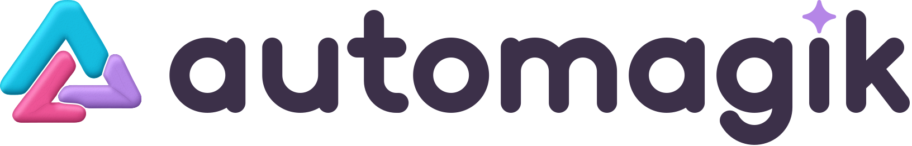
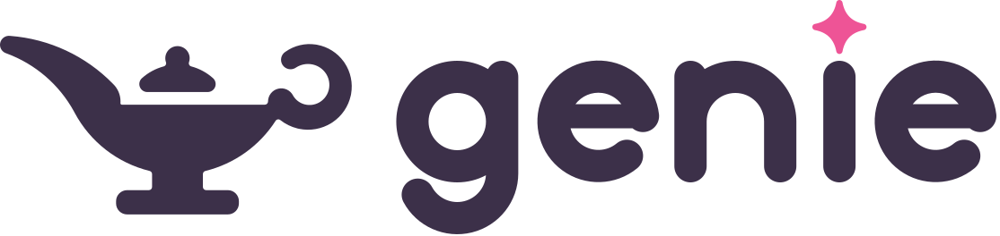
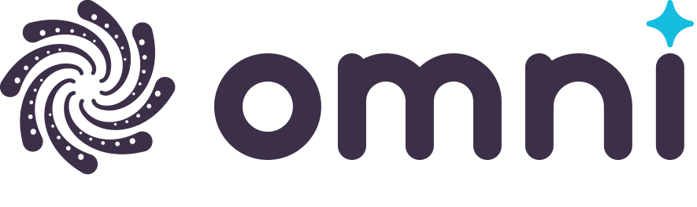
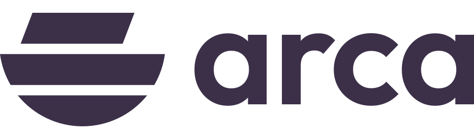
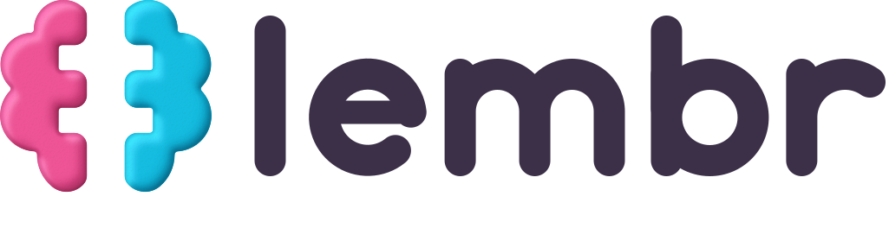
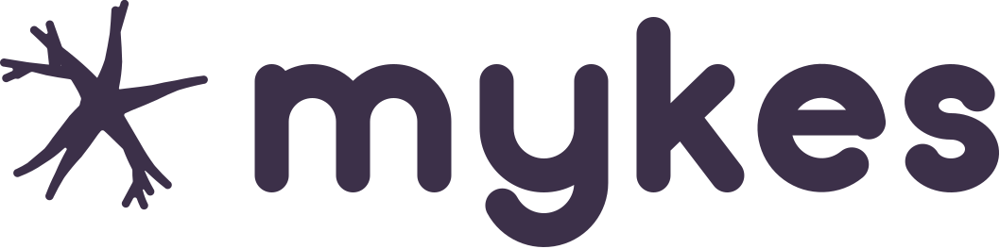

# felipe rosa

AI researcher. I build [open building blocks of superintelligence](https://automagik.si).

My work sits at the intersection of research, agents and infrastructure: the open stack that helps people do more with AI, rather than be replaced by it. All of it is built to find out how much one person can do alone, dogfooding my own tools every day.

every model release invalidates previous assumptions. context, on the other hand, survives.. don't get attached to code.

## automagik

<a href="https://automagik.si"><picture><source media="(prefers-color-scheme: dark)" srcset="assets/logos/automagik-night.svg"></picture></a>

**Your AI helpers, inside the chats you already use.** One product, two modes: **Team**, where your AI helpers work in your chats, and **Code**, where they work in your code. The helpers ask before they act as you.

- **Automagik Desktop**: your agent team in your chats, a place to talk, hand work over and review what comes back. Mac and Linux, Windows soon.
- **Automagik Mobile**: your coding agents on your Android phone, paired to your own machines. iPhone soon.
- **Plugins** for DeepSeek Harness, via the [plugin market](https://github.com/automagik-si/dsh-marketplace).

Download at [automagik.si](https://automagik.si) · source in [automagik-si/automagik](https://github.com/automagik-si/automagik)

<a href="https://github.com/automagik-si/genie"><picture><source media="(prefers-color-scheme: dark)" srcset="assets/logos/genie-night.svg"></picture></a>

Wishes in, PRs out. Turn a wish into a branch, a test run and a report you approve. Genie interviews you, plans the work, dispatches parallel agents in isolated worktrees, and reviews code before you see it.

<a href="https://github.com/automagik-si/omni"><picture><source media="(prefers-color-scheme: dark)" srcset="assets/logos/omni-night.svg"></picture></a>

Connect your chat apps to your agents: WhatsApp, Telegram, Slack, Discord and more, with channels and canvases in the same window. Universal, event-driven omnichannel for AI agents.

## infrastructure and memory

<a href="https://github.com/automagik-si/arca"><picture><source media="(prefers-color-scheme: dark)" srcset="assets/logos/arca-night.svg"></picture></a>

**Be your own cloud.** Infrastructure for agentic AI: run your own apps, databases and agents on a machine you own. You ask in plain words, and every change waits for your yes. The machine stays yours, so leaving costs nothing.

<a href="https://deck.weunfold.ai/#lembr"><picture><source media="(prefers-color-scheme: dark)" srcset="assets/logos/lembr-night.svg"></picture></a>

**Everything you know, found with its source in under 1.5 seconds** (p95 over 300 questions on a public dataset of 5,183 documents). A core that answers with its sources, won't guess, and corrects or forgets on request. lembr has no screen: it is building blocks, and products are made from them.

<a href="https://deck.weunfold.ai/#mykes"><picture><source media="(prefers-color-scheme: dark)" srcset="assets/logos/mykes-night.svg"></picture></a>

**One shared memory for a whole team of agents.** Like a mycelium: one living network, many agents, knowledge flowing to the one that needs it. Built on lembr's blocks, so it inherits their sources and corrections. Coming soon.

### [Tactu](https://deck.weunfold.ai/#tactu)

**AI that does your errands, not just talks about them.** Tactu gives the AI a phone of its own, with the apps you already use, and works through each screen like a person. It learns on real phones and real apps, not in a lab.

## research and open tools

**[Unfold](https://github.com/weunfold/unfold)**: a voice-first agent for macOS and the testbed for RTH, a real-time harness. One always-on daemon runs several models side by side (a fast local opener, a router that sets the thinking budget, a hosted or local reply model), stops the moment you talk over it, and logs every step to a readable Mind stream. Each capability is scored on fixed tasks; self-improvement is still being built.

**[dehype](https://github.com/namastex888/dehype)**: a daily bilingual AI reality briefing and live ranking of papers and repos. Evidence over hype. Numbers are never invented. [Live](https://namastex888.github.io/dehype/).

**[worthit](https://github.com/namastex888/worthit)**: what an AI coding subscription is really worth. One local command that prices every request at API list rates and shows which plan gave more. `npx worthit`

**[LocalFleet](https://github.com/namastex888/localfleet)**: private AI that chats, sees, listens and forecasts, on the computers you already own.

**[mikro](https://github.com/automagik-si/mikro)**: RLM-powered CLI research tool. Prompt externalization, Python REPL, pi/ai LLM client.

**[autopg](https://github.com/automagik-si/autopg)**: embedded PostgreSQL 18. Zero config, auto-provisioned databases, real concurrent connections.

**[Workit](https://github.com/automagik-si/workit)**: Google Workspace CLI for agents. Headless OAuth, Drive sync.

The rest of the family lives in [automagik-si](https://github.com/automagik-si). Docs: [docs.automagik.dev](https://docs.automagik.dev). All of it is part of [we unfold](https://weunfold.ai), the home of the Open Intelligence movement: a future more people can understand, question, and shape. The full map is in the [project deck](https://deck.weunfold.ai).

## retired

*These did their job. The market moved, the models improved, we moved with them. 205★ across these — proof they mattered before they didn't.*

[**Forge**](https://github.com/automagik-si/forge) — UI for humans to watch AI code step-by-step. Then models got reliable enough that you don't need to babysit anymore. The CLI orchestrates, you review the output.

[**Murmurai**](https://github.com/namastexlabs/murmurai) — Drop-in replacement for paid transcription APIs. Self-hosted, GPU-powered, speaker diarization. Retired.

[**Hive**](https://github.com/namastexlabs/automagik-hive) — Multi-agent factory with YAML configs. Market moved past it.

[**Spark**](https://github.com/namastexlabs/automagik-spark) — AI agents that work while you sleep. Market evolved faster than we did.

[**Tools**](https://github.com/namastexlabs/automagik-tools) — API to MCP in 30 seconds. Then CLI-first made MCP unnecessary.

[**Automagik CLI**](https://github.com/namastexlabs/automagik-cli) — The old chat CLI. Genie replaced it.

---

<!-- optional personal closer: delete this paragraph if the wording is not right -->
I spent two years in the mountains, lived in China, Korea and the US, and I still play music and practice yoga and meditation. I got off the bus.

[x.com/ferosa888](https://x.com/ferosa888) · [LinkedIn](https://www.linkedin.com/in/felipecrosa/) · [automagik.si](https://automagik.si) · [namastex.ai](https://namastex.ai) · [weunfold.ai](https://weunfold.ai)
